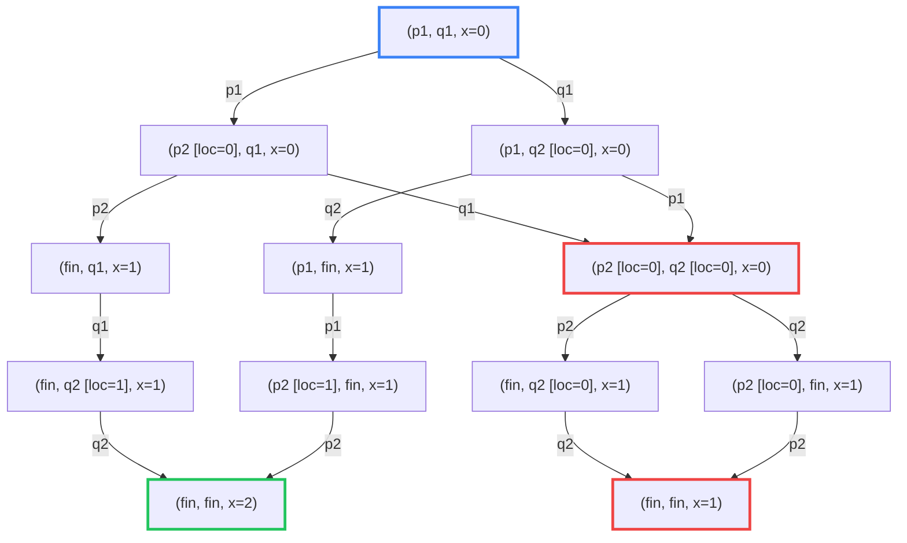
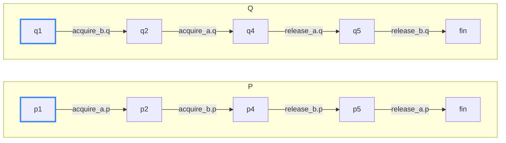
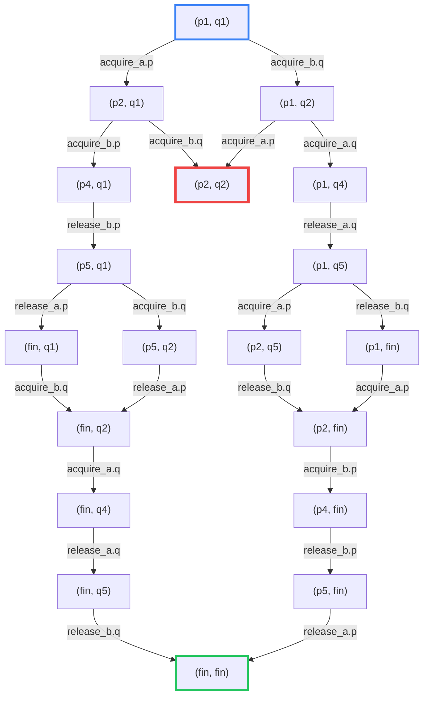
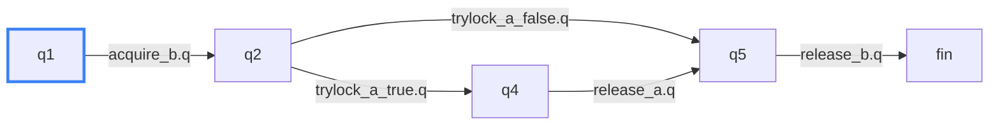
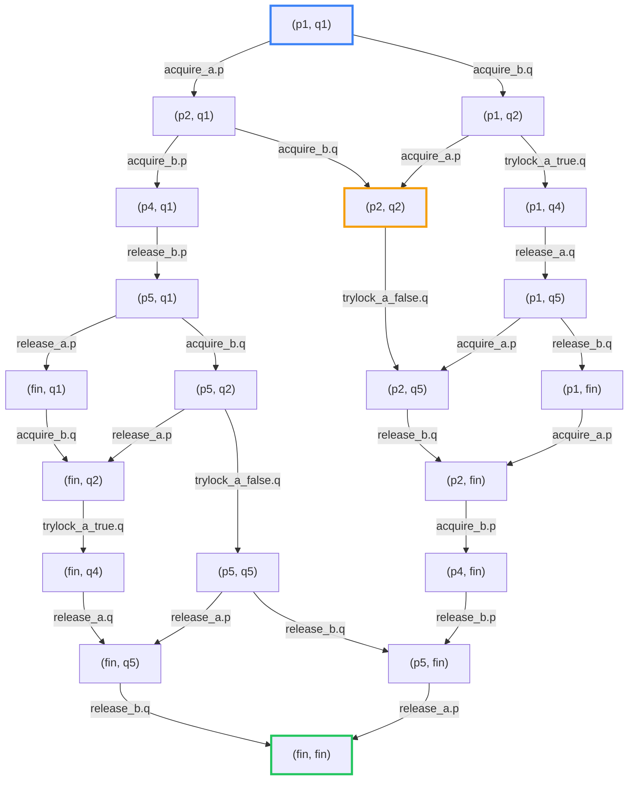
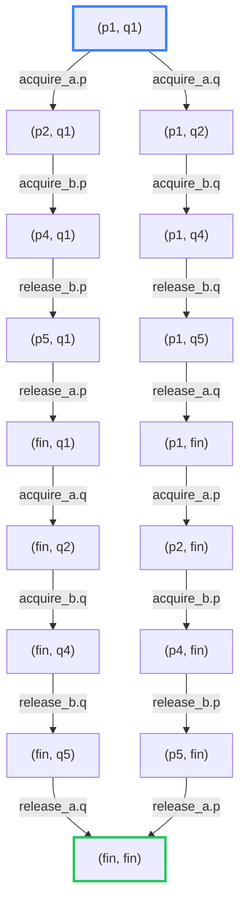

# Ejercicio 1 

# Ejercicio 2
El LTS de `p` y `q` por separado: 



Y el LTS de la composición es: 


Los caminos más cortos hacia un deadlock tienen largo 2 y son las ejecuciones en las que p toma `a` (`acquire_a.p`) y q toma `b` (`acquire_b.q`), en cualquiera de los dos órdenes. Ambas llegan al estado `(p2, q2)`, donde p tiene `a` y espera `b`, y q tiene `b` y espera `a`, por lo que ninguna acción está habilitada.

1. $(p_1,q_1) \xrightarrow{\text{acquire\_a.p}} (p_2,q_1) \xrightarrow{\text{acquire\_b.q}} (p_2,q_2)$
2. $(p_1,q_1) \xrightarrow{\text{acquire\_b.q}} (p_1,q_2) \xrightarrow{\text{acquire\_a.p}} (p_2,q_2)$

Suponiendo que el thread `q()` pasa a usar `tryLock()`, su código va a ser: 

```c
void q() {
q1: b.lock()
q2: if(a.tryLock()){
q3:     usar()
q4:     a.unlock()
q5: }
q6: b.unlock()
}
```

El LTS de `q` va a ser: 



El LTS de la composición va a ser: 



No hay deadlock porque todos los estados tienen al menos una transición saliente. El único que no tiene ninguna es `fin` (que se puede pensar que tiene un loop en sí mismo). Tampoco se pueden producir ciclos dentro del LTS.

Si el orden de adquisición es igual entre los dos threads, el LTS va a ser: 



No hay deadlock porque todo estado distinto de (`fin`, `fin`) tiene exactamente una transición saliente y no se produce ningún ciclo. Entonces de todo nodo se puede llegar al final.