# Ejercicio 1 
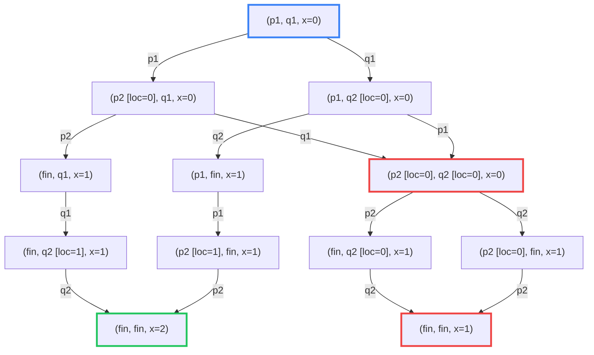
# Ejercicio 2
El LTS de `p` y `q` por separado: 

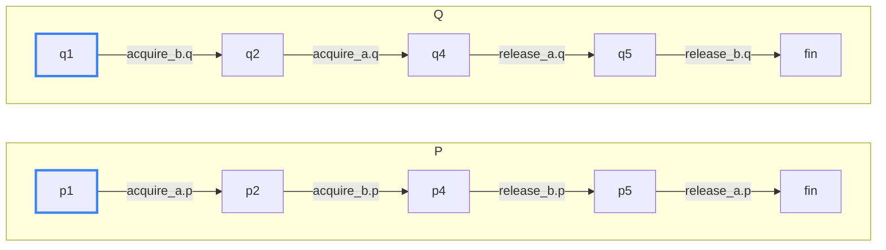

Y el LTS de la composición es: 
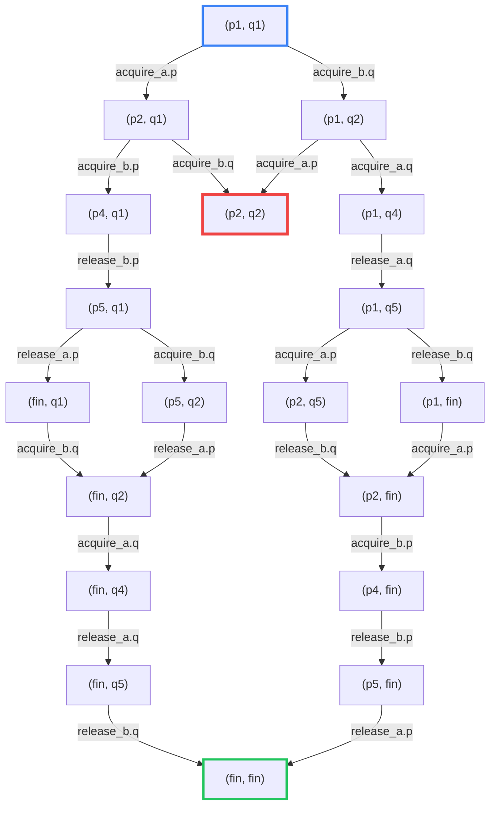

Los caminos más cortos hacia un deadlock tienen largo 2 y son las ejecuciones en las que p toma `a` (`acquire_a.p`) y q toma `b` (`acquire_b.q`), en cualquiera de los dos órdenes. Ambas llegan al estado `(p2, q2)`, donde p tiene `a` y espera `b`, y q tiene `b` y espera `a`, por lo que ninguna acción está habilitada.

1. $(p_1,q_1) \xrightarrow{\text{acquire\_a.p}} (p_2,q_1) \xrightarrow{\text{acquire\_b.q}} (p_2,q_2)$
2. $(p_1,q_1) \xrightarrow{\text{acquire\_b.q}} (p_1,q_2) \xrightarrow{\text{acquire\_a.p}} (p_2,q_2)$

Suponiendo que el thread `q()` pasa a usar `tryLock()`, su código va a ser: 

```c
void q() {
q1: b.lock()
q2: if(a.tryLock()){
q3:     usar()
q4:     a.unlock()
q5: }
q6: b.unlock()
}
```

El LTS de `q` va a ser: 

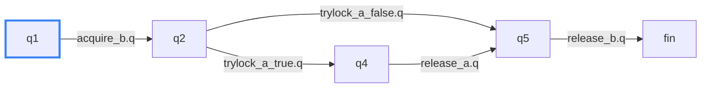

El LTS de la composición va a ser: 

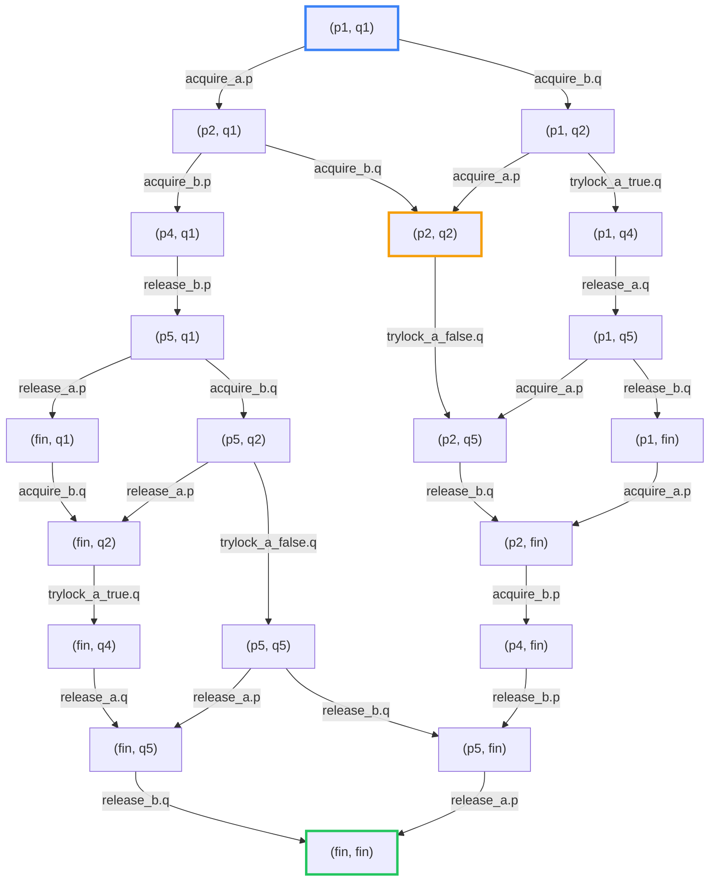

No hay deadlock porque todos los estados tienen al menos una transición saliente. El único que no tiene ninguna es `fin` (que se puede pensar que tiene un loop en sí mismo). Tampoco se pueden producir ciclos dentro del LTS.

Si el orden de adquisición es igual entre los dos threads, el LTS va a ser: 

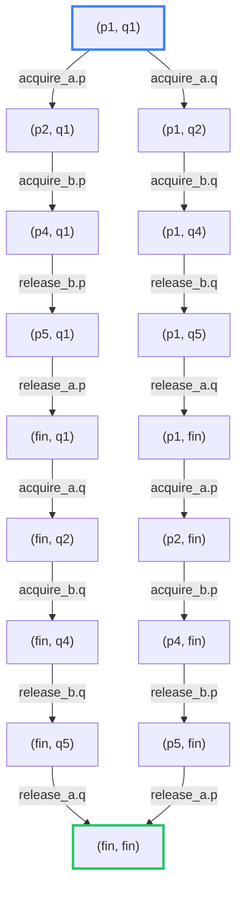

No hay deadlock porque todo estado distinto de (`fin`, `fin`) tiene exactamente una transición saliente y no se produce ningún ciclo. Entonces de todo nodo se puede llegar al final.

# Ejercicio 3 
Para el caso sin buffer para cada thread el LTS va a ser: 

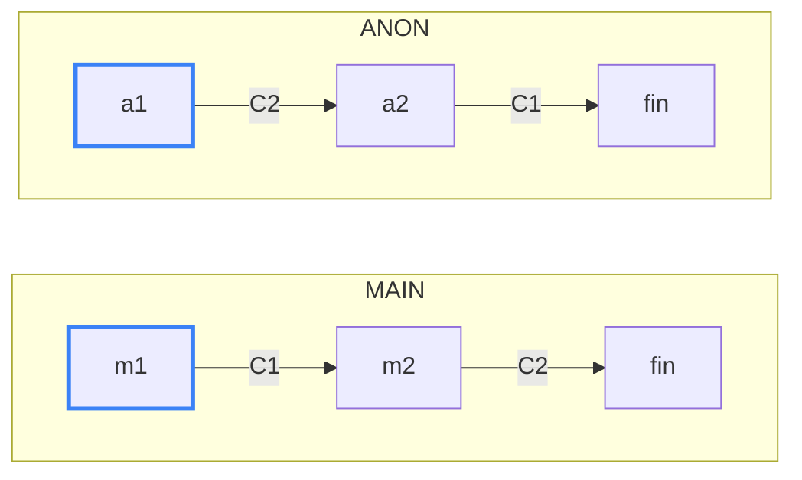

Como los canales no tienen buffer, enviar y recibir son un único evento: el envío por un canal queda bloqueado hasta que otra goroutine esté lista para recibir por ese mismo canal, y lo mismo al revés. Por eso `C1` y `C2` son acciones compartidas entre MAIN y ANON, y solo ocurren si las dos las ofrecen a la vez.

Por lo tanto al hacer la composicion el LTS solo se compone de un estado porque las transiciones no se pueden hacer al necesitar que los dos a la vez hagan la accion de enviar y recibir sobre el mismo buffer. Por lo tanto es un deadlock ya que nos quedamos trabados en un estado que no es el final. 

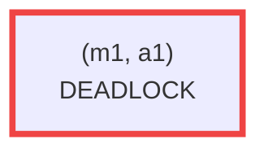

Ahora si el Buffer tiene capacidad uno, no es necesario que el emisor y receptor esten sincronizados para hacer el envio, por lo tanto los LTS de cada componente por separado va a ser: 

**MAIN**

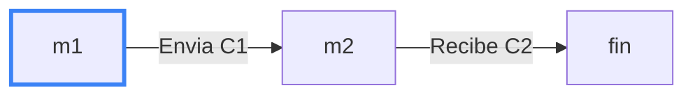

**ANON**

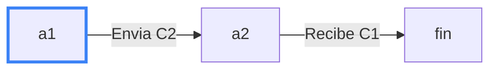

**C1** (canal `c1` con buffer de 1)

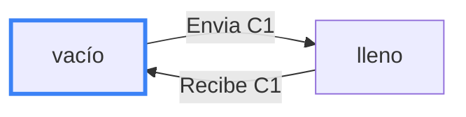

**C2** (canal `c2` con buffer de 1)

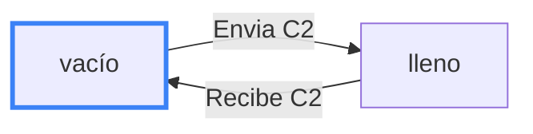

La composicion va a ser: 

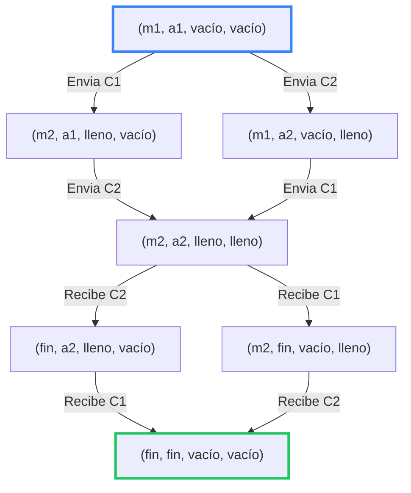

Esta versión no puede quedar bloqueada. Si un proceso intenta recibir antes de que el otro haya enviado, queda esperando (no tiene transición habilitada), pero el otro proceso siempre puede avanzar: cada goroutine hace su envío antes de su recepción, y como los buffers arrancan vacíos, el envío nunca se bloquea. Cuando el dato queda en el buffer, la recepción pendiente se habilita. En el LTS de la composición, el único estado sin transiciones salientes es `(fin, fin, vacío, vacío)`, que es la terminación correcta, así que no existe ningún deadlock.

# Ejercicio 4 
# Ejercicio 4

### 1. $\square\Diamond q$

*Desde cualquier posición, más adelante (o en ella misma) vale $q$. Es decir, $q$ ocurre infinitas veces.*

- $\sigma_1 = \{p\}\,\{p,q\}\,\{q\}\,(\{p\})^\omega$: **No vale.**
    - $q$ vale por última vez en $i = 3$. Desde $i \geq 4$ solo vale $p$, así que $\Diamond q$ falla ahí y, por lo tanto, $\square\Diamond q$ falla en $i = 1$.
- $\sigma_2 = (\{p\}\,\{q\})^\omega$: **Vale.**
    - $q$ vale en todas las posiciones pares. En las impares vale en la posición siguiente.
- $\sigma_3 = \{q\}\,\emptyset\,(\{p,q\})^\omega$: **Vale.**
    - En $i = 1$ vale $q$. En $i = 2$ vale en la posición siguiente. Desde $i = 3$ vale siempre.
- $\sigma_4 = \{p\}\,\emptyset\,(\{p,q\}\,\{p\}\,\emptyset)^\omega$: **Vale.**
    - $q$ vale en $i = 3, 6, 9, \dots$, es decir, infinitas veces. Desde cualquier posición hay un $q$ más adelante.

### 2. $\Diamond\square p$

*Eventualmente siempre se cumple $p$.*

- $\sigma_1 = \{p\}\,\{p,q\}\,\{q\}\,(\{p\})^\omega$: **Vale.**
    - A partir de $i = 4$ siempre vale $p$.
- $\sigma_2 = (\{p\}\,\{q\})^\omega$: **No vale.**
    - En las posiciones pares no vale $p$, por lo tanto no existe un $i$ tal que a partir de ese $i$ siempre valga $p$.
- $\sigma_3 = \{q\}\,\emptyset\,(\{p,q\})^\omega$: **Vale.**
    - A partir de $i = 3$ siempre vale $p$.
- $\sigma_4 = \{p\}\,\emptyset\,(\{p,q\}\,\{p\}\,\emptyset)^\omega$: **No vale.**
    - No existe $i$ tal que a partir de ese $i$ valga $p$ para todas las posiciones, ya que hay posiciones en las que no se cumple nada.

### 3. $p \,\mathbf{U}\, q$

*$q$ vale en algún momento y, hasta entonces, vale $p$.*

- $\sigma_1 = \{p\}\,\{p,q\}\,\{q\}\,(\{p\})^\omega$: **Vale.**
    - En $i = 1$ vale $p$ y $q$ aparece en $i = 2$. En $i = 2$ y $i = 3$ vale $q$ ahí mismo. Entonces $p \,\mathbf{U}\, q$ vale para $1 \leq i \leq 3$. Desde $i = 4$ ya no vale, porque $q$ no vuelve a ocurrir.
- $\sigma_2 = (\{p\}\,\{q\})^\omega$: **Vale.**
    - En las posiciones pares vale $q$ ahí mismo. En las impares vale $p$ y en la posición siguiente vale $q$. Entonces vale para todo $i$.
- $\sigma_3 = \{q\}\,\emptyset\,(\{p,q\})^\omega$: **Vale.**
    - En $i = 1$ vale $q$ ahí mismo, así que no se le pide nada a $p$. En $i = 2$ falla (no vale ni $p$ ni $q$), pero eso no afecta a $i = 1$. Desde $i = 3$ vale $q$ en todas las posiciones.
- $\sigma_4 = \{p\}\,\emptyset\,(\{p,q\}\,\{p\}\,\emptyset)^\omega$: **No vale.**
    - En $i = 1$ vale $p$, pero en $i = 2$ no vale ni $p$ ni $q$, y $q$ todavía no apareció. La fórmula falla en $i = 1$. En general, solo vale en $i = 3, 6, 9, \dots$ (donde vale $q$ ahí mismo).

### 4. $\square(p \rightarrow \Diamond q)$

*Cada vez que vale $p$, en ese momento o más adelante vale $q$.*

- $\sigma_1 = \{p\}\,\{p,q\}\,\{q\}\,(\{p\})^\omega$: **No vale.**
    - Una vez que se entra al ciclo de $p$ nunca mas ocurre $q$.
- $\sigma_2 = (\{p\}\,\{q\})^\omega$: **Vale.**
    - Siempre luego de una $p$ hay una $q$.
- $\sigma_3 = \{q\}\,\emptyset\,(\{p,q\})^\omega$: **Vale.**
    - Siempre que se cumple $p$ tambien se cumple $q$.
- $\sigma_4 = \{p\}\,\emptyset\,(\{p,q\}\,\{p\}\,\emptyset)^\omega$: **Vale.**
    - Siempre luego de una $p$ en dos pasos se cumple $q$.

### 5. $\bigcirc\bigcirc q$

*En la posición $i = 3$ vale $q$.*

- $\sigma_1 = \{p\}\,\{p,q\}\,\{q\}\,(\{p\})^\omega$: **Vale.**
- $\sigma_2 = (\{p\}\,\{q\})^\omega$: **No vale.**
    - En $i = 3$ vale $p$ y no $q$.
- $\sigma_3 = \{q\}\,\emptyset\,(\{p,q\})^\omega$: **Vale.**
- $\sigma_4 = \{p\}\,\emptyset\,(\{p,q\}\,\{p\}\,\emptyset)^\omega$: **Vale.**

### 6. $\square(p \,\mathbf{U}\, q)$

*Siempre vale que $q$ ocurre en algun momento, y hasta entonces se cumple $p$.*

- $\sigma_1 = \{p\}\,\{p,q\}\,\{q\}\,(\{p\})^\omega$: **No vale.**
    - A partir de $i = 4$ no se vuelve a cumplir $q$.
- $\sigma_2 = (\{p\}\,\{q\})^\omega$: **Vale.**
    - Para toda posicion o se cumple $q$ o se cumple $p$ y luego se va a cumplir $q$.
- $\sigma_3 = \{q\}\,\emptyset\,(\{p,q\})^\omega$: **No vale.**
    - No vale para $i = 2$, por lo que no vale, en esa posicion no vale ni $p$ ni $q$.
- $\sigma_4 = \{p\}\,\emptyset\,(\{p,q\}\,\{p\}\,\emptyset)^\omega$: **No vale.**
    - No vale para $i = 2$ porque no se cumple ni $p$ ni $q$ en esa posicion, por lo que no se cumple.