# Ejercicio 1 
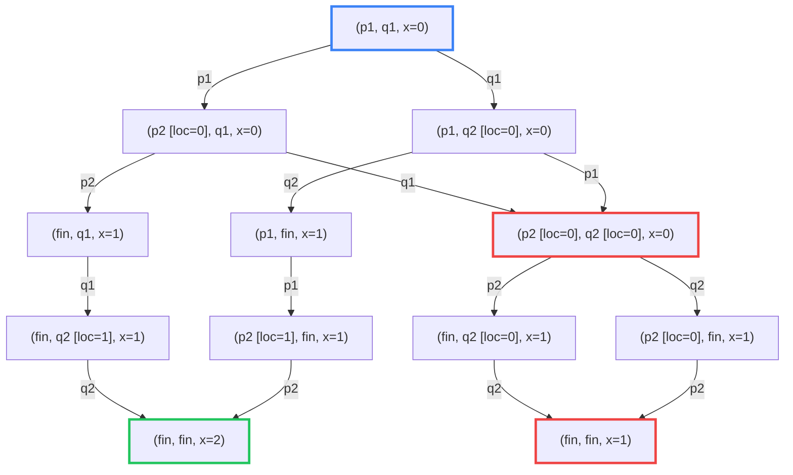
# Ejercicio 2
El LTS de `p` y `q` por separado: 

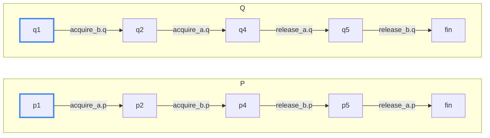

Y el LTS de la composición es: 
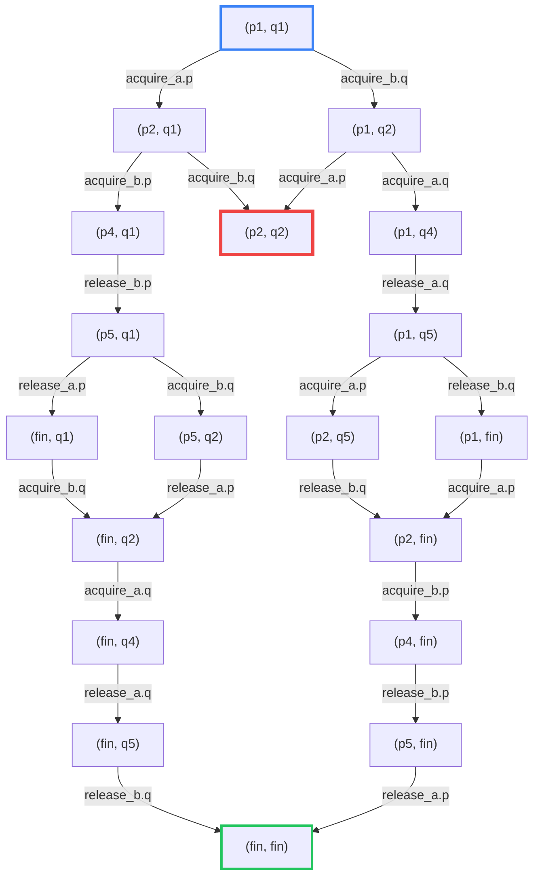

Los caminos más cortos hacia un deadlock tienen largo 2 y son las ejecuciones en las que p toma `a` (`acquire_a.p`) y q toma `b` (`acquire_b.q`), en cualquiera de los dos órdenes. Ambas llegan al estado `(p2, q2)`, donde p tiene `a` y espera `b`, y q tiene `b` y espera `a`, por lo que ninguna acción está habilitada.

1. $(p_1,q_1) \xrightarrow{\text{acquire\_a.p}} (p_2,q_1) \xrightarrow{\text{acquire\_b.q}} (p_2,q_2)$
2. $(p_1,q_1) \xrightarrow{\text{acquire\_b.q}} (p_1,q_2) \xrightarrow{\text{acquire\_a.p}} (p_2,q_2)$

Suponiendo que el thread `q()` pasa a usar `tryLock()`, su código va a ser: 

```c
void q() {
q1: b.lock()
q2: if(a.tryLock()){
q3:     usar()
q4:     a.unlock()
q5: }
q6: b.unlock()
}
```

El LTS de `q` va a ser: 

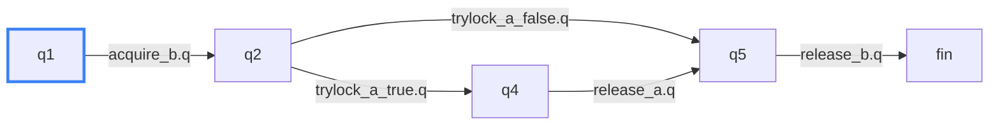

El LTS de la composición va a ser: 

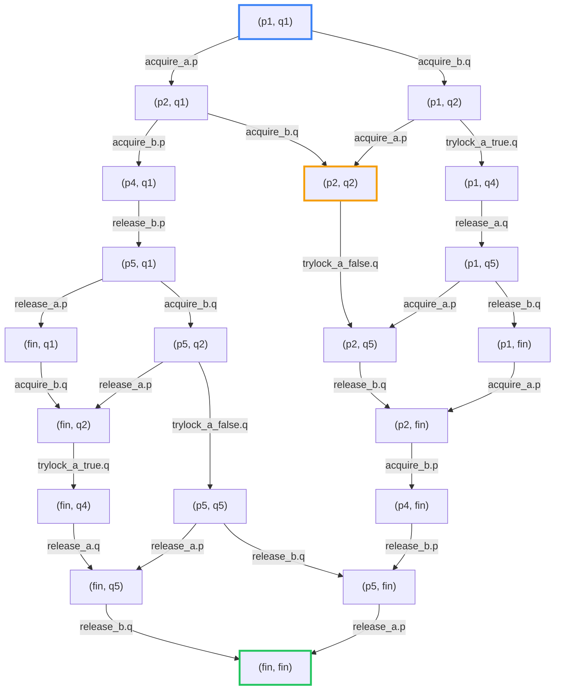

No hay deadlock porque todos los estados tienen al menos una transición saliente. El único que no tiene ninguna es `fin` (que se puede pensar que tiene un loop en sí mismo). Tampoco se pueden producir ciclos dentro del LTS.

Si el orden de adquisición es igual entre los dos threads, el LTS va a ser: 

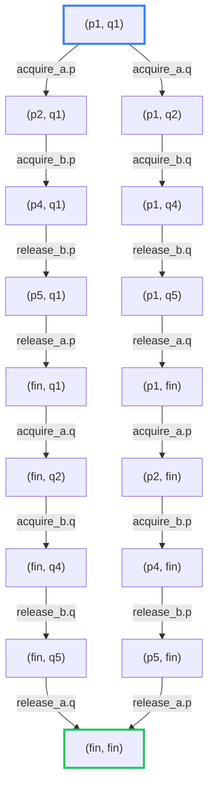

No hay deadlock porque todo estado distinto de (`fin`, `fin`) tiene exactamente una transición saliente y no se produce ningún ciclo. Entonces de todo nodo se puede llegar al final.

# Ejercicio 3 
Para el caso sin buffer para cada thread el LTS va a ser: 

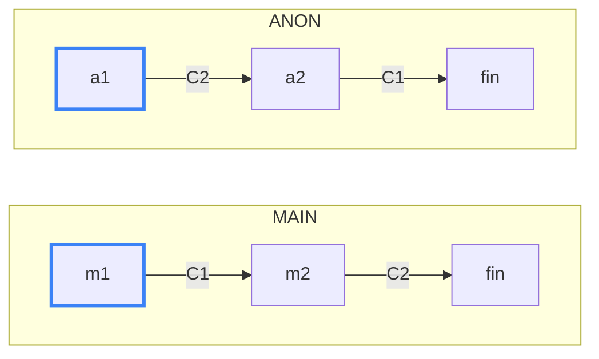

Como los canales no tienen buffer, enviar y recibir son un único evento: el envío por un canal queda bloqueado hasta que otra goroutine esté lista para recibir por ese mismo canal, y lo mismo al revés. Por eso `C1` y `C2` son acciones compartidas entre MAIN y ANON, y solo ocurren si las dos las ofrecen a la vez.

Por lo tanto al hacer la composicion el LTS solo se compone de un estado porque las transiciones no se pueden hacer al necesitar que los dos a la vez hagan la accion de enviar y recibir sobre el mismo buffer. Por lo tanto es un deadlock ya que nos quedamos trabados en un estado que no es el final. 

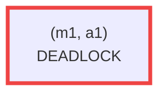

Ahora si el Buffer tiene capacidad uno, no es necesario que el emisor y receptor esten sincronizados para hacer el envio, por lo tanto los LTS de cada componente por separado va a ser: 

**MAIN**

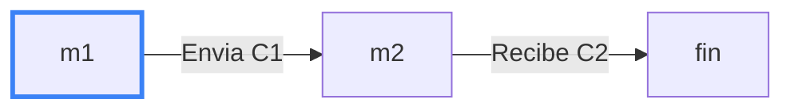

**ANON**

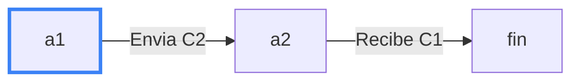

**C1** (canal `c1` con buffer de 1)

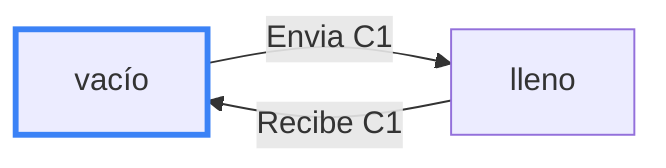

**C2** (canal `c2` con buffer de 1)

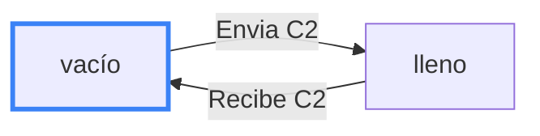

La composicion va a ser: 

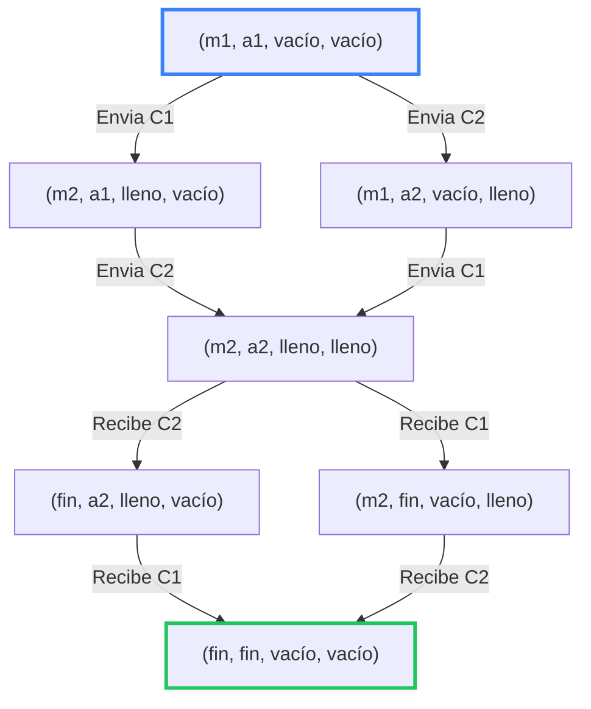

Esta versión no puede quedar bloqueada. Si un proceso intenta recibir antes de que el otro haya enviado, queda esperando (no tiene transición habilitada), pero el otro proceso siempre puede avanzar: cada goroutine hace su envío antes de su recepción, y como los buffers arrancan vacíos, el envío nunca se bloquea. Cuando el dato queda en el buffer, la recepción pendiente se habilita. En el LTS de la composición, el único estado sin transiciones salientes es `(fin, fin, vacío, vacío)`, que es la terminación correcta, así que no existe ningún deadlock.

# Ejercicio 4 
# Ejercicio 4

### 1. $\square\Diamond q$

*Desde cualquier posición, más adelante (o en ella misma) vale $q$. Es decir, $q$ ocurre infinitas veces.*

- $\sigma_1 = \{p\}\,\{p,q\}\,\{q\}\,(\{p\})^\omega$: **No vale.**
    - $q$ vale por última vez en $i = 3$. Desde $i \geq 4$ solo vale $p$, así que $\Diamond q$ falla ahí y, por lo tanto, $\square\Diamond q$ falla en $i = 1$.
- $\sigma_2 = (\{p\}\,\{q\})^\omega$: **Vale.**
    - $q$ vale en todas las posiciones pares. En las impares vale en la posición siguiente.
- $\sigma_3 = \{q\}\,\emptyset\,(\{p,q\})^\omega$: **Vale.**
    - En $i = 1$ vale $q$. En $i = 2$ vale en la posición siguiente. Desde $i = 3$ vale siempre.
- $\sigma_4 = \{p\}\,\emptyset\,(\{p,q\}\,\{p\}\,\emptyset)^\omega$: **Vale.**
    - $q$ vale en $i = 3, 6, 9, \dots$, es decir, infinitas veces. Desde cualquier posición hay un $q$ más adelante.

### 2. $\Diamond\square p$

*Eventualmente siempre se cumple $p$.*

- $\sigma_1 = \{p\}\,\{p,q\}\,\{q\}\,(\{p\})^\omega$: **Vale.**
    - A partir de $i = 4$ siempre vale $p$.
- $\sigma_2 = (\{p\}\,\{q\})^\omega$: **No vale.**
    - En las posiciones pares no vale $p$, por lo tanto no existe un $i$ tal que a partir de ese $i$ siempre valga $p$.
- $\sigma_3 = \{q\}\,\emptyset\,(\{p,q\})^\omega$: **Vale.**
    - A partir de $i = 3$ siempre vale $p$.
- $\sigma_4 = \{p\}\,\emptyset\,(\{p,q\}\,\{p\}\,\emptyset)^\omega$: **No vale.**
    - No existe $i$ tal que a partir de ese $i$ valga $p$ para todas las posiciones, ya que hay posiciones en las que no se cumple nada.

### 3. $p \,\mathbf{U}\, q$

*$q$ vale en algún momento y, hasta entonces, vale $p$.*

- $\sigma_1 = \{p\}\,\{p,q\}\,\{q\}\,(\{p\})^\omega$: **Vale.**
    - En $i = 1$ vale $p$ y $q$ aparece en $i = 2$. En $i = 2$ y $i = 3$ vale $q$ ahí mismo. Entonces $p \,\mathbf{U}\, q$ vale para $1 \leq i \leq 3$. Desde $i = 4$ ya no vale, porque $q$ no vuelve a ocurrir.
- $\sigma_2 = (\{p\}\,\{q\})^\omega$: **Vale.**
    - En las posiciones pares vale $q$ ahí mismo. En las impares vale $p$ y en la posición siguiente vale $q$. Entonces vale para todo $i$.
- $\sigma_3 = \{q\}\,\emptyset\,(\{p,q\})^\omega$: **Vale.**
    - En $i = 1$ vale $q$ ahí mismo, así que no se le pide nada a $p$. En $i = 2$ falla (no vale ni $p$ ni $q$), pero eso no afecta a $i = 1$. Desde $i = 3$ vale $q$ en todas las posiciones.
- $\sigma_4 = \{p\}\,\emptyset\,(\{p,q\}\,\{p\}\,\emptyset)^\omega$: **No vale.**
    - En $i = 1$ vale $p$, pero en $i = 2$ no vale ni $p$ ni $q$, y $q$ todavía no apareció. La fórmula falla en $i = 1$. En general, solo vale en $i = 3, 6, 9, \dots$ (donde vale $q$ ahí mismo).

### 4. $\square(p \rightarrow \Diamond q)$

*Cada vez que vale $p$, en ese momento o más adelante vale $q$.*

- $\sigma_1 = \{p\}\,\{p,q\}\,\{q\}\,(\{p\})^\omega$: **No vale.**
    - Una vez que se entra al ciclo de $p$ nunca mas ocurre $q$.
- $\sigma_2 = (\{p\}\,\{q\})^\omega$: **Vale.**
    - Siempre luego de una $p$ hay una $q$.
- $\sigma_3 = \{q\}\,\emptyset\,(\{p,q\})^\omega$: **Vale.**
    - Siempre que se cumple $p$ tambien se cumple $q$.
- $\sigma_4 = \{p\}\,\emptyset\,(\{p,q\}\,\{p\}\,\emptyset)^\omega$: **Vale.**
    - Siempre luego de una $p$ en dos pasos se cumple $q$.

### 5. $\bigcirc\bigcirc q$

*En la posición $i = 3$ vale $q$.*

- $\sigma_1 = \{p\}\,\{p,q\}\,\{q\}\,(\{p\})^\omega$: **Vale.**
- $\sigma_2 = (\{p\}\,\{q\})^\omega$: **No vale.**
    - En $i = 3$ vale $p$ y no $q$.
- $\sigma_3 = \{q\}\,\emptyset\,(\{p,q\})^\omega$: **Vale.**
- $\sigma_4 = \{p\}\,\emptyset\,(\{p,q\}\,\{p\}\,\emptyset)^\omega$: **Vale.**

### 6. $\square(p \,\mathbf{U}\, q)$

*Siempre vale que $q$ ocurre en algun momento, y hasta entonces se cumple $p$.*

- $\sigma_1 = \{p\}\,\{p,q\}\,\{q\}\,(\{p\})^\omega$: **No vale.**
    - A partir de $i = 4$ no se vuelve a cumplir $q$.
- $\sigma_2 = (\{p\}\,\{q\})^\omega$: **Vale.**
    - Para toda posicion o se cumple $q$ o se cumple $p$ y luego se va a cumplir $q$.
- $\sigma_3 = \{q\}\,\emptyset\,(\{p,q\})^\omega$: **No vale.**
    - No vale para $i = 2$, por lo que no vale, en esa posicion no vale ni $p$ ni $q$.
- $\sigma_4 = \{p\}\,\emptyset\,(\{p,q\}\,\{p\}\,\emptyset)^\omega$: **No vale.**
    - No vale para $i = 2$ porque no se cumple ni $p$ ni $q$ en esa posicion, por lo que no se cumple.

# Ejercicio 5
### 1. $\Diamond(\varphi \land \psi) \equiv \Diamond\varphi \land \Diamond\psi$

*Eventualmente ocurre $\varphi \land \psi$ equivale a que eventualmente ocurre $\varphi$ y eventualmente ocurre $\psi$*

Es falso, para la traza $(\{\varphi\} \{\psi\})^\omega$ se cumple $\Diamond\varphi \land \Diamond\psi$ pero no se cumple $\Diamond(\varphi \land \psi)$ porque nunca ocurren las dos a la vez. 

### 2. $\Box(\varphi \land \psi) \equiv \Box\varphi \land \Box\psi$

Es verdadero. Sea $\sigma$ una traza cualquiera. Demuestro que $\sigma \models \Box(\varphi \land \psi)$ si y solo si $\sigma \models \Box\varphi \land \Box\psi$.

**($\Rightarrow$)** Supongamos $\sigma \models \Box(\varphi \land \psi)$. Entonces para todo $i \geq 0$, $\sigma, i \models \varphi \land \psi$, y en particular $\sigma, i \models \varphi$ y $\sigma, i \models \psi$. Luego $\sigma \models \Box\varphi$ y $\sigma \models \Box\psi$, es decir, $\sigma \models \Box\varphi \land \Box\psi$.

**($\Leftarrow$)** Supongamos $\sigma \models \Box\varphi \land \Box\psi$. Entonces para todo $i \geq 0$, $\sigma, i \models \varphi$ y $\sigma, i \models \psi$, es decir, $\sigma, i \models \varphi \land \psi$. Luego $\sigma \models \Box(\varphi \land \psi)$.


### 3. $\bigcirc\Diamond\varphi \equiv \Diamond\bigcirc\varphi$
*En la segunda posición se cumple eventualmente $\varphi$ equivale a que existe una posición cuya siguiente cumple $\varphi$*

Es verdadero. Sea $\sigma$ una traza cualquiera (posiciones numeradas desde 1). Vale la siguiente cadena de equivalencias:

$\sigma \models \bigcirc\Diamond\varphi$

$\iff \sigma, 2 \models \Diamond\varphi$ (semántica de $\bigcirc$)

$\iff$ existe $j \geq 2$ tal que $\sigma, j \models \varphi$ (semántica de $\Diamond$)

$\iff$ existe $x \geq 1$ tal que $\sigma, x+1 \models \varphi$ (cambio de variable $x = j-1$)

$\iff$ existe $x \geq 1$ tal que $\sigma, x \models \bigcirc\varphi$ (semántica de $\bigcirc$)

$\iff \sigma \models \Diamond\bigcirc\varphi$ (semántica de $\Diamond$)

### 4. $\Box\Diamond\varphi \rightarrow \Box\Diamond\psi \equiv \Box(\varphi \rightarrow \Diamond\psi)$

*Siempre se cumple eventualmente $\varphi$ implica que siempre se cumple eventualmente $\psi$ equivale a siempre se cumple que si vale $\varphi$ entonces eventualmente vale $\psi$*.
 
Es falso. Para la traza $\sigma = \{\varphi\}, (\emptyset)^\omega$:

- Vale $\Box\Diamond\varphi \rightarrow \Box\Diamond\psi$, porque el antecedente es falso: $\varphi$ solo ocurre en la posición 1, por lo que en la posición 2 no vale $\Diamond\varphi$ y entonces $\sigma \not\models \Box\Diamond\varphi$.
- No vale $\Box(\varphi \rightarrow \Diamond\psi)$, porque en la posición 1 vale $\varphi$ pero $\psi$ no ocurre nunca, entonces $\sigma, 1 \not\models \varphi \rightarrow \Diamond\psi$.


### 5. $\Box\varphi \rightarrow \Diamond\psi \equiv \varphi \,\mathbf{U}\, (\psi \lor \neg\varphi)$

*Si siempre ocurre $\varphi$ entonces eventualmente ocurre $\psi$ equivale a que en algún momento ocurre $\psi \lor \neg\varphi$ (es decir, ocurre $\psi$ o deja de valer $\varphi$), y hasta entonces (sin incluirlo) vale $\varphi$*.

**Reescritura de $\Box\varphi \rightarrow \Diamond\psi$:**

$\Box\varphi \rightarrow \Diamond\psi$

$\equiv \neg\Box\varphi \lor \Diamond\psi$ (definición de $\rightarrow$)

$\equiv \Diamond\neg\varphi \lor \Diamond\psi$ (dualidad: $\neg\Box\varphi \equiv \Diamond\neg\varphi$)

$\equiv \Diamond(\neg\varphi \lor \psi)$ ($\Diamond$ distribuye sobre $\lor$)

Por lo tanto, basta probar que $\Diamond(\psi \lor \neg\varphi) \equiv \varphi \,\mathbf{U}\, (\psi \lor \neg\varphi)$.

**Prueba de $\Diamond(\psi \lor \neg\varphi) \equiv \varphi \,\mathbf{U}\, (\psi \lor \neg\varphi)$:** sea $\sigma$ una traza cualquiera (posiciones numeradas desde 1).

**($\Leftarrow$)** Supongamos $\sigma \models \varphi \,\mathbf{U}\, (\psi \lor \neg\varphi)$. Por semántica de $\mathbf{U}$, existe $j \geq 1$ tal que $\sigma, j \models \psi \lor \neg\varphi$. Luego $\sigma \models \Diamond(\psi \lor \neg\varphi)$.

**($\Rightarrow$)** Supongamos $\sigma \models \Diamond(\psi \lor \neg\varphi)$. Entonces existe $j \geq 1$ tal que $\sigma, j \models \psi \lor \neg\varphi$. Sea $j_0$ el mínimo de esos $j$. Entonces $\sigma, j_0 \models \psi \lor \neg\varphi$, y para todo $k$ con $1 \leq k < j_0$ vale $\sigma, k \not\models \psi \lor \neg\varphi$, es decir $\sigma, k \models \neg\psi \land \varphi$, por lo que $\sigma, k \models \varphi$. Luego $\sigma \models \varphi \,\mathbf{U}\, (\psi \lor \neg\varphi)$.

Por lo tanto $\Box\varphi \rightarrow \Diamond\psi \equiv \Diamond(\psi \lor \neg\varphi) \equiv \varphi \,\mathbf{U}\, (\psi \lor \neg\varphi)$.

# Ejercicio 6

### a) $\bigcirc\bigcirc a \rightarrow \bigcirc a$

Es satisfacible, por ejemplo para la traza $(\{a\})^\omega$ se cumple, pero no es válida porque por ejemplo para la traza $\emptyset, \emptyset, \{a\}, (\emptyset)^\omega$ no se cumple.

### b) $\bigcirc(a \lor \Diamond a) \rightarrow \Diamond a$

Es satisfacible, por ejemplo para la traza $(\{a\})^\omega$ se cumple, ya que $a$ vale en la posición 2 y por lo tanto valen antecedente y consecuente.

Es válida. Sea $\sigma$ una traza cualquiera  y supongamos que $\sigma \models \bigcirc(a \lor \Diamond a)$, es decir, $\sigma, 2 \models a \lor \Diamond a$. Si $\sigma, 2 \models a$, existe una posición donde vale $a$, luego $\sigma \models \Diamond a$. Si $\sigma, 2 \models \Diamond a$, existe $j \geq 2$ con $\sigma, j \models a$, y como $j \geq 1$, vale $\sigma \models \Diamond a$. En ambos casos se cumple el consecuente, por lo tanto la implicación vale en toda traza.

### c) $\Box a \rightarrow \neg\bigcirc(\neg a \land \Box\neg a)$

Reescribimos el lado derecho:

$\neg\bigcirc(\neg a \land \Box\neg a)$

$\equiv \bigcirc\neg(\neg a \land \Box\neg a)$ ($\neg\bigcirc\varphi \equiv \bigcirc\neg\varphi$)

$\equiv \bigcirc(a \lor \neg\Box\neg a)$ (De Morgan y doble negación)

$\equiv \bigcirc(a \lor \Diamond a)$ (dualidad: $\neg\Box\neg a \equiv \Diamond a$)

Es válida. Sea $\sigma$ una traza cualquiera y supongamos que $\sigma \models \Box a$. Por definición de $\Box$, $a$ vale en todas las posiciones de $\sigma$. En particular vale en la posición siguiente a la inicial, por lo tanto en esa posición vale $a \lor \Diamond a$, es decir, $\sigma \models \bigcirc(a \lor \Diamond a)$. Como el lado derecho es equivalente a $\bigcirc(a \lor \Diamond a)$, se cumple el consecuente, por lo tanto la implicación vale en toda traza.

Es satisfacible, ya que toda fórmula válida es satisfacible.


### d) $(\Box a)\,\mathbf{U}\,(\Diamond b) \rightarrow \Box(a\,\mathbf{U}\,\Diamond b)$

La fórmula es satisfacible, por ejemplo para $(\{a,b\})^\omega$ se cumplen ambos lados. El antecedente vale porque $\Diamond b$ vale en la posición inicial (ahí vale $b$), y el consecuente vale porque $b$ vale en todas las posiciones, entonces $\Diamond b$ vale en todas y por lo tanto $a\,\mathbf{U}\,\Diamond b$ también.

La fórmula no es válida, para la traza $\{b\}, (\emptyset)^\omega$ se cumple el antecedente porque $\Diamond b$ vale en la posición inicial (ahí vale $b$), y como no hay posiciones anteriores no hace falta que valga $\Box a$. En cambio no vale el consecuente: en la posición siguiente a la inicial $b$ no vale ni valdrá nunca, entonces $\Diamond b$ es falso ahí y no vale $a\,\mathbf{U}\,\Diamond b$, por lo tanto no vale que para toda posición se cumpla $a\,\mathbf{U}\,\Diamond b$.

### e) $\Diamond b \rightarrow (a\,\mathbf{U}\,b)$

Es satisfacible, por ejemplo para $(\{b\})^\omega$ se cumple, ya que $b$ vale en la posición inicial, entonces $a\,\mathbf{U}\,b$ se cumple de inmediato y vale el consecuente.

No es válida, para la traza $\emptyset, (\{b\})^\omega$ se cumple el antecedente porque eventualmente ocurre $b$ (en la posición siguiente a la inicial), pero es falso el consecuente porque $b$ no vale en la posición inicial, y para que valga $a\,\mathbf{U}\,b$ tendría que valer $a$ en la posición inicial, que es el único instante anterior a la primera aparición de $b$, y ahí no vale $a$.

# Ejercicio 7 

### a) Exclusión mutua: un solo thread está en la sección crítica a la vez
$\Box\neg(critical_1 \land critical_2)$

### b) Permanencia finita: ningún thread se queda en la sección crítica para siempre.
$\neg\Diamond\Box critical_1 \land \neg\Diamond\Box critical_2$

### c) Ausencia de inanición: si un thread pide el lock, eventualmente entra a la sección crítica.
$\Box(request_1 \rightarrow \Diamond critical_1) \land \Box(request_2 \rightarrow \Diamond critical_2)$

### d) Acceso alternado: los threads se turnan estrictamente para entrar a la sección crítica.
Supongo que $critical_i$ sigue valiendo en el instante en que vale $release_i$ (el thread llama a `unlock()` desde dentro de la sección crítica), por eso el $\mathbf{U}$ se evalúa desde la posición siguiente.

$\Box\big(release_1 \rightarrow \bigcirc(\neg critical_1 \,\mathbf{U}\, critical_2)\big) \land \Box\big(release_2 \rightarrow \bigcirc(\neg critical_2 \,\mathbf{U}\, critical_1)\big)$

### e) Si el thread 1 pide el lock infinitas veces, entra a la sección crítica infinitas veces.
$\Box\Diamond request_1 \rightarrow \Box\Diamond critical_1$

### f) Si a partir de algún momento el thread 1 pide el lock sin parar, entra a la sección crítica
infinitas veces.
$\Diamond\Box request_1 \rightarrow \Box\Diamond critical_1$

### g) Mientras el thread 1 espera, el thread 2 entra a la sección crítica a lo sumo una vez.

TODO

# Ejercicio 8

### $\varphi \,\mathbf{N}\, \psi$ ("en el próximo"): la próxima vez que vale $\psi$, también vale $\varphi$.
$\varphi \,\mathbf{N}\, \psi \equiv \neg\psi \,\mathbf{W}\, (\varphi \land \psi) \equiv (\neg\psi \,\mathbf{U}\, (\varphi \land \psi)) \lor \Box\neg\psi$

### $\varphi \,\mathbf{M}\, \psi$ ("mientras"): $\varphi$ vale al menos mientras valga $\psi$.

$\varphi \,\mathbf{M}\, \psi \equiv \varphi \,\mathbf{W}\, \neg\psi \equiv (\varphi \,\mathbf{U}\, \neg\psi) \lor \Box\varphi$

### $\varphi \,\mathbf{B}\, \psi$ ("antes"): si $\psi$ vale alguna vez, $\varphi$ vale antes.

$\varphi \,\mathbf{B}\, \psi \equiv \neg\psi \,\mathbf{W}\, (\varphi \land \neg\psi) \equiv (\neg\psi \,\mathbf{U}\, (\varphi \land \neg\psi)) \lor \Box\neg\psi$

Supongo que "antes" es estricto: si $\psi$ vale alguna vez, $\varphi$ tiene que haber valido en un instante anterior a la primera aparición de $\psi$ (no alcanza con que valgan en el mismo instante).

# Ejercicio 9 
$\Box\big((\neg held \,\mathbf{U}\, held) \land (held \,\mathbf{U}\, \neg held)\big)$

# Ejercicio 10 
La unica componente terminal es el LTS completo, ya que desde cualquier estado se puede llegar a cualquier otro y tampoco hay estados sin salidas. 
### $\Box(\text{TRYING} \rightarrow \Diamond\text{CRITICAL})$
Sin fair choice no vale, es una propiedad de liveness, así que el contraejemplo es un lazo. La ejecución
$\text{IDLE}\,(\text{TRYING}\,\text{BACKOFF})^\omega$ no cumple con la propiedad.

Con fair choice vale: Toda ejecución justa termina en una componente terminal y la recorre entera infinitas veces. Como la única es el LTS completo, la ejecución pasa infinitas veces por $\text{CRITICAL}$, es decir, vale $\Box\Diamond\text{CRITICAL}$. Entonces, desde cualquier posición (en particular desde las que valen $\text{TRYING}$) hay un $\text{CRITICAL}$ más adelante, y $\Box(\text{TRYING} \rightarrow \Diamond\text{CRITICAL})$ vale.

El contraejemplo anterior no es justo: visita $\text{TRYING}$ infinitas veces pero nunca toma su transición saliente $\text{acquire}$.

### $\Box(\text{TRYING} \rightarrow \Diamond(\text{CRITICAL} \lor \text{IDLE}))$

Sin fair choice no vale, al ser una propiedad de liveness un lazo es un contraejemplo. Un lazo posible puede ser: 
$\text{IDLE}\,(\text{TRYING}\,\text{BACKOFF})^\omega$ el cual no cumple con la propiedad.

Con fair choice si que vale, porque toda ejecucion justa termina en una componente terminal y la recorre entera infinitas veces. Como la unica es el LTS completo, la ejecucion pasa infinitas veces por $\text{CRITICAL}$ y por $\text{IDLE}$, es decir, vale $\Box\Diamond\text{CRITICAL}$ y $\Box\Diamond\text{IDLE}$, y $\Box(\text{TRYING} \rightarrow \Diamond(\text{CRITICAL} \lor \text{IDLE}))$ vale. 


### $\Box(\text{BACKOFF} \rightarrow \Box\neg\text{CRITICAL})$

No vale, ni con ni sin fair choice. Es una propiedad de safety, así que el contraejemplo es un prefijo finito:
$\text{IDLE}\,\text{TRYING}\,\text{BACKOFF}\,\text{TRYING}\,\text{CRITICAL}$
En la posición 3 vale $\text{BACKOFF}$, pero en la posición 5 vale $\text{CRITICAL}$, por lo que $\Box\neg\text{CRITICAL}$ falla en la posición 3.

### $\Box(\text{BACKOFF} \rightarrow \Diamond\text{TRYING})$

Vale, tanto con fair choice como sin ella. Es una propiedad de liveness, así que un contraejemplo tendría que ser un lazo en el que, desde alguna posición con $\text{BACKOFF}$, nunca vuelve a valer $\text{TRYING}$. Ese lazo no existe:

- Desde $\text{BACKOFF}$ solo hay dos transiciones: $retry$, que va a $\text{TRYING}$, y $giveup$, que va a $\text{IDLE}$.
- Si toma $retry$, llega a $\text{TRYING}$ y se cumple.
- Si toma $giveup$, llega a $\text{IDLE}$, y desde $\text{IDLE}$ la única transición es $request$, que va a $\text{TRYING}$.
- $\text{BACKOFF}$ no tiene lazo sobre sí mismo y ningún estado del camino es un estado sin salidas, así que la ejecución no puede quedarse sin pasar por $\text{TRYING}$.

Como toda ejecución que pasa por $\text{BACKOFF}$ llega a $\text{TRYING}$ en a lo sumo dos pasos, la propiedad vale para todas las ejecuciones, justas o no. Fair choice no hace falta: el protocolo mismo obliga a volver a $\text{TRYING}$.

# Ejercicio 11 
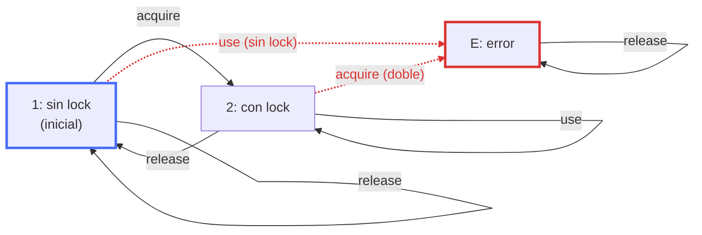

Defino "nadie usa el recurso sin haberlo adquirido" como: antes del primer use hay un acquire, y después de cada release no hay use hasta el próximo acquire:

$\text{acquire} \,\mathbf{B}\, \text{use} \;\land\; \Box(\text{release} \rightarrow \bigcirc(\text{acquire} \,\mathbf{B}\, \text{use}))$

Expandiendo $\mathbf{B}$ y $\mathbf{W}$ como arriba, $\text{acquire} \,\mathbf{B}\, \text{use} \equiv (\neg\text{use} \,\mathbf{U}\, \text{acquire}) \lor \Box\neg\text{use}$.

Defino "no hay dos acquire sin un release en el medio" como:

$\Box(\text{acquire} \rightarrow \bigcirc(\neg\text{acquire} \,\mathbf{W}\, \text{release}))$

Entonces el LTL es:

$\big((\neg\text{use} \,\mathbf{U}\, \text{acquire}) \lor \Box\neg\text{use}\big) \land \Box\big(\text{release} \rightarrow \bigcirc((\neg\text{use} \,\mathbf{U}\, \text{acquire}) \lor \Box\neg\text{use})\big) \land \Box\big(\text{acquire} \rightarrow \bigcirc(\neg\text{acquire} \,\mathbf{W}\, \text{release})\big)$

# Ejercicio 12
Siendo el codigo: 

```
int s = 1
bool y[2] = {false, false}

thread p (i = 0):                         thread q (i = 1):
loop {                                    loop {
  p1: noncritical()                         q1: noncritical()
  p2: (y[0], s) = (true, 0)                 q2: (y[1], s) = (true, 1)
  p3: await (!y[1] || s == 0)               q3: await (!y[0] || s == 1)
  p4: critical()                            q4: critical()
  p5: y[0] = false                          q5: y[1] = false
}                                         }
```

El LTS va a ser: 

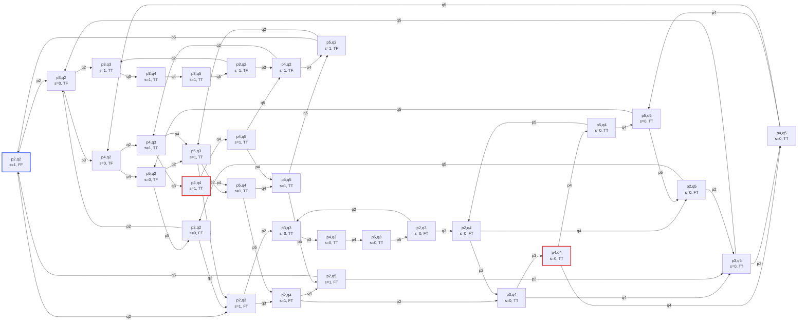

Para LTL los estados van a ser: $\text{noncritical}_i$, $\text{wait}_i$, $\text{critical}_i$ y $\text{release}_i$.

Exclusion mutua va a ser: $\Box\neg(\text{critical}_0 \land \text{critical}_1)$

Ausencia de inanicion, asumiendo que non critical siempre termina: 

$\Box\Diamond\text{critical}_0 \land \Box\Diamond\text{critical}_1$

Exclusion mutua no se cumple, un contraejemplo es la traza: 

Ejecución (transiciones: $p2$, $p3$, $q2$, $q3$). Cada estado es $(pc_p, pc_q, s, y[0]y[1])$:

$(p2, q2, s{=}1, FF)\ \xrightarrow{p2}\ (p3, q2, s{=}0, TF)\ \xrightarrow{p3}\ (p4, q2, s{=}0, TF)\ \xrightarrow{q2}\ (p4, q3, s{=}1, TT)\ \xrightarrow{q3}\ (p4, q4, s{=}1, TT)$

Traza (proposiciones que valen en cada posición):

$\{\text{noncritical}_0, \text{noncritical}_1\}\ \{\text{wait}_0, \text{noncritical}_1\}\ \{\text{critical}_0, \text{noncritical}_1\}\ \{\text{critical}_0, \text{wait}_1\}\ \{\text{critical}_0, \text{critical}_1\}\ \cdots$

En la posición 5 valen $\text{critical}_0$ y $\text{critical}_1$ a la vez, así que $\Box\neg(\text{critical}_0 \land \text{critical}_1)$ falla en la posición 1. El prefijo ya refuta la fórmula, sin importar cómo siga la ejecución. Fair choice no cambia nada, ya que solo descarta comportamientos infinitos y este contraejemplo es finito.

Sin fair choice no vale ausencia de inanicion. Es una propiedad de liveness, así que el contraejemplo es un lazo (la otra mitad de la fórmula es simétrica):

tramo: $(p2,q2,1,FF) \xrightarrow{q2} (p2,q3,1,FT) \xrightarrow{p2} (p3,q3,0,TT)$

vuelta: $(p3,q3,0,TT) \xrightarrow{p3} (p4,q3,0,TT) \xrightarrow{p4} (p5,q3,0,TT) \xrightarrow{p5} (p2,q3,0,FT) \xrightarrow{p2} (p3,q3,0,TT)$

En toda la vuelta vale $\text{wait}_1$ y nunca $\text{critical}_1$. Este lazo no es justo: visita $(p2,q3,0,FT)$ infinitas veces y nunca toma $q3$, que está habilitada ahí.

Con fair choice vale. Toda ejecución justa termina en una componente terminal y la recorre entera infinitas veces. El LTS es fuertemente conexo y no tiene estados sin salidas, así que la única componente terminal son los 32 estados. Contiene estados con $\text{critical}_0$ y con $\text{critical}_1$, por lo que valen $\Box\Diamond\text{critical}_0$ y $\Box\Diamond\text{critical}_1$. Entonces, desde cualquier posición con $\text{wait}_i$ hay un $\text{critical}_i$ más adelante.

# Ejercicio 13 
```
int y1 = 0, y2 = 0

thread p (thread 1):                      thread q (thread 2):
loop {                                    loop {
  p1: noncritical()                         q1: noncritical()
  p2: y1 = y2 + 1                           q2: y2 = y1 + 1
  p3: await (y2 == 0 || y1 < y2)            q3: await (y1 == 0 || y2 < y1)
  p4: critical()                            q4: critical()
  p5: y1 = 0                                q5: y2 = 0
}                                         }
```

El LTS va a ser: 

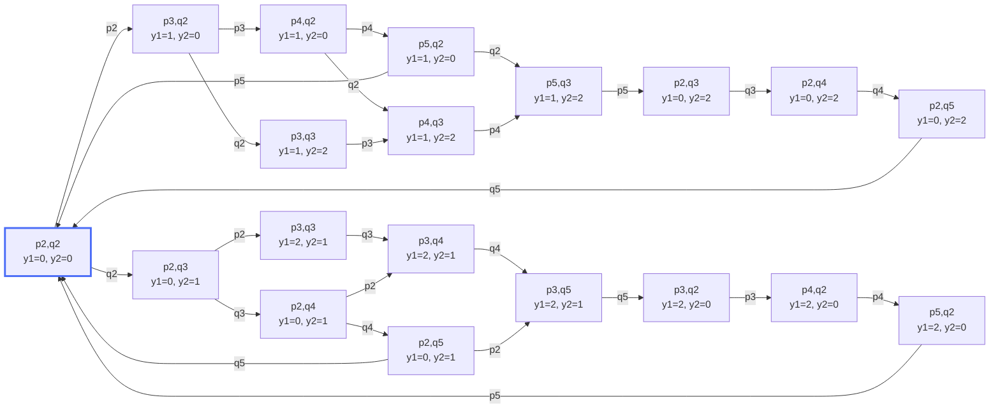

El patron para que los `y` puedan valer mas que 2 es una traza del estilo: 

### Traza infinita

| Paso | Transición | Estado resultante (`pc_p, pc_q` \| `y1, y2`) |
|---|---|---|
| 0 | (inicial) | `p2,q2 \| 0, 0` |
| 1 | `p2`: `y1 = y2 + 1` | `p3,q2 \| 1, 0` |
| 2 | `q2`: `y2 = y1 + 1` | `p3,q3 \| 1, 2` |
| 3 | `p3`: `await (y2 == 0 \|\| y1 < y2)` (1 < 2) | `p4,q3 \| 1, 2` |
| 4 | `p4`: `critical()` | `p5,q3 \| 1, 2` |
| 5 | `p5`: `y1 = 0` | `p2,q3 \| 0, 2` |
| 6 | `p2`: `y1 = y2 + 1` | `p3,q3 \| 3, 2` |
| 7 | `q3`: `await (y1 == 0 \|\| y2 < y1)` (2 < 3) | `p3,q4 \| 3, 2` |
| 8 | `q4`: `critical()` | `p3,q5 \| 3, 2` |
| 9 | `q5`: `y2 = 0` | `p3,q2 \| 3, 0` |
| 10 | `q2`: `y2 = y1 + 1` | `p3,q3 \| 3, 4` |
| 11 | `p3`: `await (y2 == 0 \|\| y1 < y2)` (3 < 4) | `p4,q3 \| 3, 4` |
| 12 | `p4`: `critical()` | `p5,q3 \| 3, 4` |
| 13 | `p5`: `y1 = 0` | `p2,q3 \| 0, 4` |
| 14 | `p2`: `y1 = y2 + 1` | `p3,q3 \| 5, 4` |
| ... | se repite desde el paso 7 | `p3,q3 \| 7, 6`, `p3,q3 \| 9, 8`, ... |

Los pasos 7 a 14 forman un ciclo en los `pc` (de `p3,q3` a `p3,q3`) donde los valores suben en 2. El estado en `p3,q3` es `y1 = 2k+1, y2 = 2k`, con k = 1, 2, 3, ... Nunca se repite, así que el LTS completo tiene infinitos estados.

Traza como secuencia de etiquetas:

`p2, q2, p3, p4, p5, p2, (q3, q4, q5, q2, p3, p4, p5, p2)^ω`

Para LTL los estados van a ser: $\text{noncritical}_i$, $\text{wait}_i$, $\text{critical}_i$ y $\text{release}_i$.

Exclusion mutua va a ser: $\Box\neg(\text{critical}_0 \land \text{critical}_1)$

Ausencia de inanicion: 
$\Box\Diamond\text{critical}_0 \land \Box\Diamond\text{critical}_1$

Ausencia de Deadlock: TODO

Exclusion mutua se cumple porque ningún estado del LTS tiene `p4` y `q4` a la vez. Para entrar a `p4` hace falta `y2 = 0 ∨ y1 < y2`, y para entrar a `q4` hace falta `y1 = 0 ∨ y2 < y1`. Si ambos tuvieran `y ≠ 0`, las dos condiciones serían `y1 < y2` e `y2 < y1`, que no pueden valer juntas.

Ausencia de inanicion asumiendo un scheduler fair se cumple porque todo el LTS forma la misma componente terminal, por lo que podemos asumir que se va a pasar por todos los estados infinitas veces. 

Ausencia de Deadlock: TODO. 

# Ejercicio 14 
Si no tienen buffer los LTS de cada uno van a ser: 

Cliente 1:

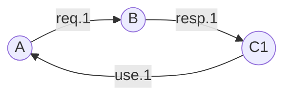

Cliente 2:

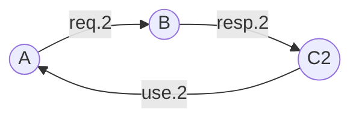

Servidor:

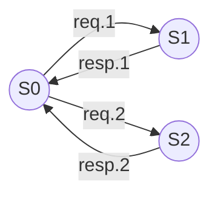

La composicion va a ser: 

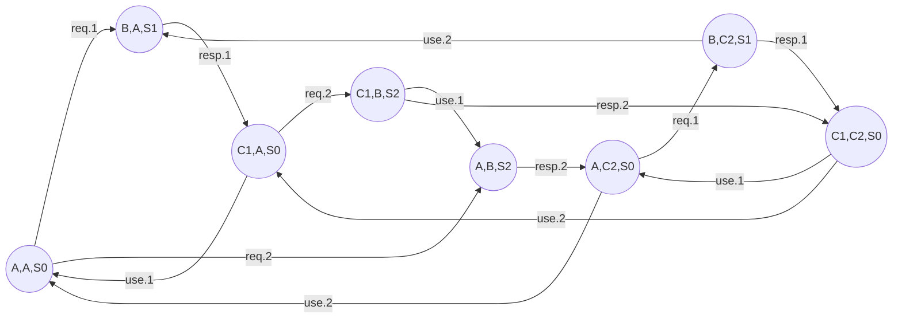

Ahora si `requests` es un buffer rendeavouz y `responses` tiene capacidad 1: 

Buffer:

```mermaid
flowchart TB
    Vacio((Vacio)) -->|"envia 1"| Lleno1((Lleno1))
    Vacio -->|"envia 2"| Lleno2((Lleno2))
    Lleno1 -->|"1 recibe 1"| Vacio
    Lleno1 -->|"2 recibe 1"| Vacio
    Lleno2 -->|"1 recibe 2"| Vacio
    Lleno2 -->|"2 recibe 2"| Vacio
```

Cliente 1:

```mermaid
flowchart LR
    Ok((Ok)) -->|"1 pide"| Esperando((Esperando))
    Mal((Mal)) -->|"1 pide"| Esperando
    Esperando -->|"1 recibe 1"| Ok
    Esperando -->|"1 recibe 2"| Mal
```

Cliente 2:

```mermaid
flowchart LR
    Ok((Ok)) -->|"2 pide"| Esperando((Esperando))
    Mal((Mal)) -->|"2 pide"| Esperando
    Esperando -->|"2 recibe 2"| Ok
    Esperando -->|"2 recibe 1"| Mal
```

Servidor:

```mermaid
flowchart LR
    Libre((Libre)) -->|"1 pide"| Atiende1((Atiende1))
    Libre -->|"2 pide"| Atiende2((Atiende2))
    Atiende1 -->|"envia 1"| Libre
    Atiende2 -->|"envia 2"| Libre
```

El LTS de la composicion va a ser: 

```mermaid
flowchart TB
    n0(("O,O,Lb,V"))
    n1(("E,O,A1,V"))
    n2(("O,E,A2,V"))
    n3(("E,O,Lb,L1"))
    n4(("O,E,Lb,L2"))
    n5(("E,E,A2,L1"))
    n6(("E,E,A1,L2"))
    n7(("E,M,A2,V"))
    n8(("M,E,A1,V"))
    n9(("E,M,Lb,L2"))
    n10(("M,E,Lb,L1"))
    n11(("M,M,Lb,V"))
    n12(("E,E,A2,L2"))
    n13(("E,E,A1,L1"))
    n14(("E,M,A1,V"))
    n15(("M,E,A2,V"))
    n16(("E,O,A2,V"))
    n17(("O,E,A1,V"))
    n18(("E,M,Lb,L1"))
    n19(("M,E,Lb,L2"))
    n20(("E,O,Lb,L2"))
    n21(("O,E,Lb,L1"))
    n22(("O,M,Lb,V"))
    n23(("M,O,Lb,V"))

    n0 -->|"1 pide"| n1
    n0 -->|"2 pide"| n2
    n1 -->|"envia 1"| n3
    n2 -->|"envia 2"| n4
    n3 -->|"1 recibe 1"| n0
    n3 -->|"2 pide"| n5
    n4 -->|"2 recibe 2"| n0
    n4 -->|"1 pide"| n6
    n5 -->|"1 recibe 1"| n2
    n5 -->|"2 recibe 1"| n7
    n6 -->|"1 recibe 2"| n8
    n6 -->|"2 recibe 2"| n1
    n7 -->|"envia 2"| n9
    n8 -->|"envia 1"| n10
    n9 -->|"1 recibe 2"| n11
    n9 -->|"2 pide"| n12
    n10 -->|"2 recibe 1"| n11
    n10 -->|"1 pide"| n13
    n11 -->|"1 pide"| n14
    n11 -->|"2 pide"| n15
    n12 -->|"1 recibe 2"| n15
    n12 -->|"2 recibe 2"| n16
    n13 -->|"1 recibe 1"| n17
    n13 -->|"2 recibe 1"| n14
    n14 -->|"envia 1"| n18
    n15 -->|"envia 2"| n19
    n16 -->|"envia 2"| n20
    n17 -->|"envia 1"| n21
    n18 -->|"1 recibe 1"| n22
    n18 -->|"2 pide"| n5
    n19 -->|"2 recibe 2"| n23
    n19 -->|"1 pide"| n6
    n20 -->|"1 recibe 2"| n23
    n20 -->|"2 pide"| n12
    n21 -->|"2 recibe 1"| n22
    n21 -->|"1 pide"| n13
    n22 -->|"1 pide"| n14
    n22 -->|"2 pide"| n2
    n23 -->|"1 pide"| n1
    n23 -->|"2 pide"| n15

    classDef malo fill:#f66,stroke:#900,color:#000
    class n7,n8,n9,n10,n11,n14,n15,n18,n19,n22,n23 malo
```

Para definir las proposiciones en LTL, los estados van a ser OK_i para cuando un cliente no mando nada o recibio su mensaje correctamente, Esperando_i cuando envio un mensaje y esta esperando respuesta y Mal_i cuando recibe una respuesta incorrecta. 

Para la propiedad de que cada cliente recibe siempre la
respuesta a su propio pedido, basta con pedir que nunca se este en un estado de mal, entonces: $\Box \neg mal_1 \land \Box \neg mal_2$

Para que todo cliente que manda un pedido termina recibiendo
una respuesta: $\Box (\mathit{esperando}_i \rightarrow \Diamond (\mathit{ok}_i \lor \mathit{mal}_i))$.

Para la primer version, la primer propiedad se cumple, porque no es alcanzable un estado en el cual o el 1 reciba response 2 o que el 2 reciba response 1 por la composicion de LTS. La segunda propiedad si el scheduler es unfair no se cumple, si es fair se cumple porque forma todo parte de la misma componente terminal por lo que se va a psar infinitamente por todos los estados, pasando por alguno en el que ambos reciben respuestas eventualmente. 

Para la segunda version la primer propiedad no vale porque es posible llegar a estados en el cual se recibe la respuesta cacheada del otro. La segunda propiedad vale con un scheduler fair. 