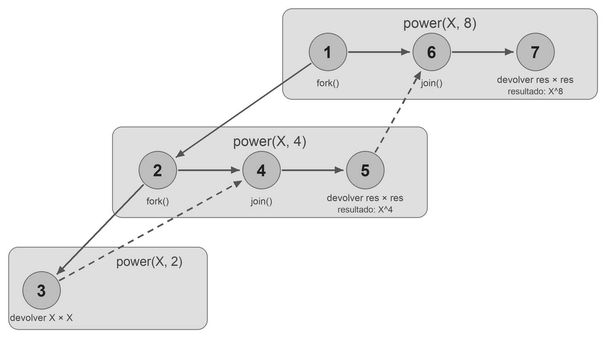

# Ejercicio 1 
Sea $T_1$ los pasos para el programa original y $T_1'$ el del programa optimizado, equivalentes a sus tiempos de ejecución con un solo procesador. Entonces:
- $T_1 = 2048$
- $T_1' = 1024$

La cota que tenemos es: $T_P \approx \frac{T_1}{P} + T_\infty$. 

Entonces reemplazando conociendo $T_1$, $T_1'$ y el $P_1 = 32$ y $P_2 = 512$: 

$T_{32} \approx \frac{2048}{32} + T_\infty = 64 + T_\infty$

$T'_{32} \approx \frac{1024}{32} + T'_\infty = 32 + T'_\infty$

Si lo escalamos 512 procesadores: 

$T_{512} \approx \frac{2048}{512} + T_\infty = 4 + T_\infty$

$T'_{512} \approx \frac{1024}{512} + T'_\infty = 2 + T'_\infty$

Sabemos entonces que $32 + T'_\infty < 64 + T_\infty$ y queremos que: $4 + T_\infty < 2 + T'_\infty$

Entonces: 
$T'_\infty - T_\infty < 32$ y $2 < T'_\infty - T_\infty$

Por lo tanto $2 < T'_\infty - T_\infty < 32$. 

Por lo tanto para que se cumpla que el programa optimizado sea más rapido con 32 procesadores pero mas lento con 512, su span debe superar al del programa original en más de 2 pasos y menos de 32 pasos. 

Como regla general, reducir el trabajo total no garantiza mejorar el rendimiento para cualquier cantidad de procesadores. Según esta estimación, al aumentar $P$, disminuye el término $T_1/P$ y cobra mayor importancia el span. Por eso, una optimización que reduce trabajo pero aumenta el camino crítico puede resultar beneficiosa con pocos procesadores y perjudicial con muchos.

Matemáticamente, la versión optimizada es más rápida cuando:

$$
\underbrace{\frac{T_1-T'_1}{P}}_{\text{ahorro por reducir trabajo}}
>
\underbrace{T'_\infty-T_\infty}_{\text{aumento del span}}
$$

# Ejercicio 2 
TODO 

# Ejercicio 3

Sabemos que el programa se ejecuta con un scheduler greedy y que:

$$
T_4 = 80, \qquad T_{64} = 10.
$$

Usamos la ley del work, la ley del span y la cota del ejercicio 2:

$$
T_P \geq \frac{T_1}{P},
\qquad
T_P \geq T_\infty,
\qquad
T_P \leq \frac{T_1-T_\infty}{P}+T_\infty.
$$

Aplicando estas desigualdades para $P=4$ y $P=64$, obtenemos:

$$
\begin{cases}
80 \leq \dfrac{T_1-T_\infty}{4}+T_\infty, \\
80 \geq \dfrac{T_1}{4}, \\
80 \geq T_\infty, \\
10 \leq \dfrac{T_1-T_\infty}{64}+T_\infty, \\
10 \geq \dfrac{T_1}{64}, \\
10 \geq T_\infty.
\end{cases}
$$

De las desigualdades de la ley del work:

$$
80 \geq \frac{T_1}{4}
\iff T_1 \leq 320,
\qquad
10 \geq \frac{T_1}{64}
\iff T_1 \leq 640.
$$

Tomando la cota superior más ajustada y considerando que el trabajo total es al menos un paso:

$$
1 \leq T_1 \leq 320.
$$

De la ley del span, tenemos $T_\infty \leq 80$ y $T_\infty \leq 10$. Por lo tanto:

$$
1 \leq T_\infty \leq 10.
$$

Ahora aplicamos la cota del ejercicio 2 con $P=10$ y agrupamos los términos con $T_\infty$:

$$
\begin{aligned}
T_{10}
&\leq \frac{T_1-T_\infty}{10}+T_\infty \\
&= \frac{T_1}{10}-\frac{T_\infty}{10}+T_\infty \\
&= \frac{T_1}{10}+\frac{9}{10}T_\infty.
\end{aligned}
$$

Como los coeficientes de $T_1$ y $T_\infty$ son positivos, podemos reemplazarlos por sus cotas superiores:

$$
T_{10}
\leq \frac{T_1}{10}+\frac{9}{10}T_\infty
\leq \frac{320}{10}+\frac{9}{10}\cdot 10
=32+9=41.
$$

Por lo tanto, con 10 procesadores y un scheduler greedy, el programa toma **como máximo 41 pasos de ejecución**:

$$
\boxed{T_{10} \leq 41}.
$$

# Ejercicio 4 
La solución va a ser: 

```java 
import java.util.concurrent.ForkJoinPool;
import java.util.concurrent.RecursiveTask;

public class VectorSumTask extends RecursiveTask<Integer> {
    private final int[] vector;
    private final int left;
    private final int right;

    // Rango: [left, right)
    // left incluido, right excluido.
    public VectorSumTask(int[] vector, int left, int right) {
        this.vector = vector;
        this.left = left;
        this.right = right;
    }

    @Override
    protected Integer compute() {
        int cantidad = right - left;
        if (cantidad == 2) {
            return vector[left] + vector[left + 1];
        }
        int middle = left + (right - left) / 2;
        VectorSumTask rightTask = new VectorSumTask(vector, middle, right);
        rightTask.fork();
        VectorSumTask leftTask = new VectorSumTask(vector, left, middle);

        return leftTask.compute() + rightTask.join();
    }
}
```

Sea $S_P(n)$ el tiempo que toma sumar los elementos de un vector de longitud $n$ con $P$ procesadores. Para esta implementación suponemos que $n \geq 2$ es potencia de 2; el caso base tiene costo constante:

$$
S_1(2)=\Theta(1), \qquad S_\infty(2)=\Theta(1).
$$

Cada llamada no base crea dos subtareas de tamaño $n/2$ y hace $\Theta(1)$ de trabajo adicional: calcular el punto medio, crear las tareas, gestionar el fork-join y sumar los dos resultados. No se copian elementos del vector: ambas tareas reciben el mismo vector con rangos diferentes.

- **Work:** con un solo procesador se realiza el trabajo de ambas mitades, por lo que sus costos se suman:

  $$
  S_1(n)=2S_1(n/2)+\Theta(1)=\Theta(n).
  $$

- **Span:** con procesadores ilimitados, las dos mitades pueden calcularse en paralelo. Se toma el máximo de sus duraciones y se agrega el costo constante de cada nivel:

  $$
  S_\infty(n)=\max\{S_\infty(n/2),S_\infty(n/2)\}+\Theta(1)
  =S_\infty(n/2)+\Theta(1)=\Theta(\log n).
  $$

- **Paralelismo:** es el cociente entre el work y el span:

  $$
  \frac{S_1(n)}{S_\infty(n)}=\Theta\left(\frac{n}{\log n}\right).
  $$

# Ejercicio 5 
La solución va a ser: 

```java 
import java.util.concurrent.ForkJoinPool;
import java.util.concurrent.RecursiveTask;

public class PowerTask extends RecursiveTask<Integer> {

    private final int x; 
    private final int c;

    public PowerTask(int x, int c) {
        this.x = x;
        this.c = c;
    }

    @Override
    protected Integer compute() {
        if(c == 0){
            return 1;
        }
        if(c == 1){
            return x;
        }
        if(c == 2){
            return x * x;
        }
        PowerTask task = new PowerTask(x, c/2);
        task.fork();
        int res = task.join();
        if(c % 2 == 1){
            return res * res * x;
        }
        return res * res;
    }

}
```
Si tomo cada paso como un nodo, ignorando los ifs:


El work va a ser igual a 7, el span tambien va a ser igual a 7 porque no hay nada que se pueda paralelizar ya que todos los pasos dependen de su paso anterior. Por lo tanto el paralelismo va a ser igual a 1. 

# Ejercicio 6
```java 
import java.util.ArrayList;
import java.util.List;
import java.util.concurrent.ForkJoinPool;
import java.util.concurrent.RecursiveAction;

public class TransposeTask extends RecursiveAction {

    private final int[][] matrix;
    private final int rowStart;
    private final int rowEnd;
    private final int colStart;
    private final int colEnd;

    // Filas: [rowStart, rowEnd), columnas: [colStart, colEnd).
    // Los inicios están incluidos y los finales están excluidos.
    public TransposeTask(int[][] matrix, int rowStart, int rowEnd,
                         int colStart, int colEnd) {
        this.matrix = matrix;
        this.rowStart = rowStart;
        this.rowEnd = rowEnd;
        this.colStart = colStart;
        this.colEnd = colEnd;
    }

    @Override
    public void compute() {
        int cantidadElementos = (rowEnd - rowStart) * (colEnd - colStart);
        if(cantidadElementos == 4){
            for(int i = rowStart; i < rowEnd; i++){
                for(int j = colStart; j < colEnd; j++){
                    if(i < j){
                        int aux = matrix[i][j];
                        matrix[i][j] = matrix[j][i];
                        matrix[j][i] = aux;
                    }
                }
            }
            return;
        }
        List <TransposeTask> tasks = new ArrayList<>(4);
        int mitadFilas = rowStart + (rowEnd - rowStart) / 2;
        int mitadColumnas = colStart + (colEnd - colStart) / 2;
        
        tasks.add(new TransposeTask(matrix, rowStart, mitadFilas, colStart, mitadColumnas));
        tasks.add(new TransposeTask(matrix, rowStart, mitadFilas, mitadColumnas, colEnd));
        tasks.add(new TransposeTask(matrix, mitadFilas, rowEnd, colStart, mitadColumnas));
        tasks.add(new TransposeTask(matrix, mitadFilas, rowEnd, mitadColumnas, colEnd));
        
        tasks.stream().forEach((task)->{task.fork();});
        tasks.stream().forEach((task)->{task.join();});   
    }

}
```

Sea $A_P(n)$ el tiempo que toma transponer una matriz de lado $n$ con $P$ procesadores. El caso base de $2\times2$ tiene costo constante: $A_1(2)=\Theta(1)$ y $A_\infty(2)=\Theta(1)$.

- **Work:** con un solo procesador se realiza el trabajo de los cuatro cuadrantes de lado $n/2$, más $\Theta(1)$ de trabajo adicional por llamada:

  $$
  A_1(n)=4A_1(n/2)+\Theta(1)=\Theta(n^2).
  $$

  El trabajo total es cuadrático porque se recorren todas las posiciones de la matriz.

- **Span:** con procesadores ilimitados, las cuatro subtareas pueden ejecutarse en paralelo. Se toma el máximo de sus duraciones, más el costo constante de cada llamada:

  $$
  A_\infty(n)=A_\infty(n/2)+\Theta(1)=\Theta(\log n).
  $$

  Cada nivel reduce el lado del bloque a la mitad y no hay una fase de combinación que recorra sus elementos después de los joins.

- **Paralelismo:** es el cociente entre el work y el span:

  $$
  \frac{A_1(n)}{A_\infty(n)}=\Theta\left(\frac{n^2}{\log n}\right).
  $$

# Ejercicio 7

Sea $M_P(n)$ el tiempo que toma ordenar un segmento de $n$ elementos con $P$ procesadores. El caso base de un elemento tiene costo constante: $M_1(1)=\Theta(1)$ y $M_\infty(1)=\Theta(1)$.

- **Work:** se cuenta el trabajo de las dos mitades y el costo $\Theta(n)$ del merge secuencial:

  $$
  M_1(n)=2M_1(n/2)+\Theta(n)=\Theta(n\log n).
  $$

- **Span:** las dos mitades se ordenan en paralelo, pero el merge se ejecuta secuencialmente después de que ambas terminan:

  $$
  M_\infty(n)=M_\infty(n/2)+\Theta(n)=\Theta(n).
  $$

  Al desarrollar la recurrencia, los costos del merge sobre el camino crítico forman la suma geométrica $n+n/2+n/4+\cdots+1=\Theta(n)$. Aunque hay $\Theta(\log n)$ niveles, el trabajo secuencial por nivel no es constante.

- **Paralelismo:** es el cociente entre el work y el span:

  $$
  \frac{M_1(n)}{M_\infty(n)}
  =\Theta\left(\frac{n\log n}{n}\right)
  =\Theta(\log n).
  $$

# Ejercicio 8

**a)**

En cada llamada no vacía, la tarea escribe directamente un único elemento: la mediana, en su posición definitiva `A[pos_en_A]`, antes de lanzar las llamadas recursivas. La tarea izquierda escribe únicamente en las posiciones anteriores a la mediana dentro del segmento de salida de esa llamada, mientras que la derecha escribe únicamente en las posiciones posteriores. Esas regiones no se superponen y ninguna subtarea vuelve a escribir la posición de la mediana. Como esta separación se repite en cada nivel y el array de entrada `T` solo se lee, ninguna posición de salida es modificada por dos tareas distintas y no hay condiciones de carrera. El `join()` asegura que ambas partes estén completas antes de terminar la llamada padre. Por eso no hay condiciones de carrera, porque nunca hay dos procesos escribiendo en la misma posición del array.

La idea es determinar en cada llamada la posición final de un elemento. Para ubicar la mediana se cuenta cuántos elementos menores que ella hay entre los dos segmentos de entrada; ese número, sumado a `p3`, determina su posición en la salida. Después se pide recursivamente la fusión ordenada de los elementos menores para la parte anterior y la de los mayores para la parte posterior. Como todos los elementos son distintos, cada elemento restante pertenece exactamente a una de esas dos partes. Si ambas llamadas producen sus partes correctamente ordenadas, la secuencia formada por la parte izquierda, la mediana y la parte derecha también queda ordenada y contiene todos los elementos originales una sola vez. El caso base, sin elementos, es correcto de forma inmediata, y las llamadas trabajan sobre cantidades menores de elementos.

Las partes quedan unidas por su ubicación en el mismo array `A`: no hace falta copiarlas ni engancharlas después del `join()`, porque las llamadas recursivas ya escriben directamente en sus posiciones correspondientes.

**b)**

$$
\text{Work:}\quad M_1(n)=2M_1\left(\frac{n-1}{2}\right)+\Theta(\log n)=\Theta(n).
$$

$$
\text{Span:}\quad M_\infty(n)=M_\infty\left(\frac{n-1}{2}\right)+\Theta(\log n)=\Theta(\log^2 n).
$$

$$
\text{Paralelismo:}\quad \frac{M_1(n)}{M_\infty(n)}=\Theta\left(\frac{n}{\log^2 n}\right).
$$

**c)**

$$
\text{Work de mergesort:}\quad
S_1(n)=2S_1(n/2)+M_1(n)
=2S_1(n/2)+\Theta(n)
=\Theta(n\log n).
$$

$$
\text{Span de mergesort:}\quad
S_\infty(n)=S_\infty(n/2)+M_\infty(n)
=S_\infty(n/2)+\Theta(\log^2 n)
=\Theta(\log^3 n).
$$

$$
\text{Paralelismo:}\quad
\frac{S_1(n)}{S_\infty(n)}
=\Theta\left(\frac{n\log n}{\log^3 n}\right)
=\Theta\left(\frac{n}{\log^2 n}\right).
$$
